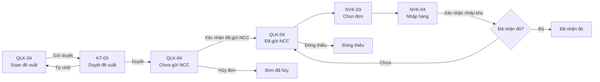
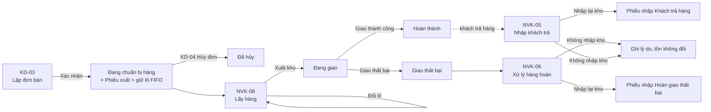
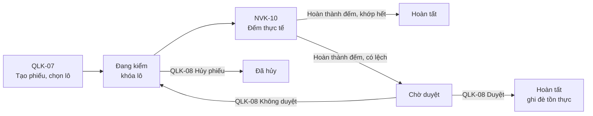

# 06. Luồng màn hình

Tài liệu này mô tả toàn bộ màn hình, đường dẫn và cách đi giữa các màn.
File HTML mẫu giao diện nằm ở `/docs/man-hinh/*.html`, tên trùng cột "File mẫu".

---

## 1. Danh mục màn hình

### 1.1. Dùng chung (mọi vai trò)

| Mã | Màn hình | Route | File mẫu |
|---|---|---|---|
| AUTH-01 | Đăng nhập | `GET /dang-nhap` | `Auth_DangNhap` |
| AUTH-02 | Đổi mật khẩu lần đầu | `GET /doi-mat-khau-lan-dau` | `Auth_DoiMatKhauLanDau` |
| AUTH-03 | Quên mật khẩu | `GET /quen-mat-khau` | `Auth_QuenMatKhau` |
| AUTH-04 | Đặt lại mật khẩu | `GET /dat-lai-mat-khau/{token}` | `Auth_DatLaiMatKhau` |
| AUTH-05 | Đổi mật khẩu | `GET /doi-mat-khau` | `Auth_DoiMatKhau` |

### 1.2. Quản trị hệ thống

| Mã | Màn hình | Route | File mẫu |
|---|---|---|---|
| ADM-01 | Trang chủ Quản trị | `GET /quan-tri` | `Main` |
| ADM-02 | Danh sách người dùng | `GET /quan-tri/nguoi-dung` | `NguoiDung` |
| ADM-03 | Thêm người dùng | `GET /quan-tri/nguoi-dung/them` | `NguoiDungForm` |
| ADM-04 | Sửa người dùng | `GET /quan-tri/nguoi-dung/{ma}` | `NguoiDungSua` |
| ADM-05 | Quản lý kho | `GET /quan-tri/kho` | `Kho` |
| ADM-06 | Nhật ký hệ thống | `GET /quan-tri/nhat-ky` | `NhatKy` |

### 1.3. Quản lý kho

| Mã | Màn hình | Route | File mẫu |
|---|---|---|---|
| QLK-01 | Trang chủ | `GET /kho` | `QLK_TrangChu` |
| QLK-02 | Theo dõi tồn kho | `GET /kho/ton-kho` | `QLK_TonKho` |
| QLK-03 | Đề xuất nhập kho (danh sách) | `GET /kho/de-xuat` | `QLK_DeXuat` |
| QLK-04 | Chi tiết đề xuất / đơn đặt hàng | `GET /kho/don/{ma}` `GET /kho/de-xuat/tao` | `QLK_ChiTietDon` |
| QLK-05 | Đơn đặt hàng (danh sách) | `GET /kho/don-dat-hang` | `QLK_DonDatHang` |
| QLK-06 | Phiếu kiểm kê (danh sách) | `GET /kho/kiem-ke` | `QLK_KiemKe` |
| QLK-07 | Tạo phiếu kiểm kê | `GET /kho/kiem-ke/tao` | `QLK_KiemKeTao` |
| QLK-08 | Chi tiết phiếu kiểm kê | `GET /kho/kiem-ke/{ma}` | `QLK_KiemKeChiTiet` |
| QLK-09 | Sản phẩm | `GET /kho/san-pham` | `QLK_SanPham` |
| QLK-10 | Nhà cung cấp | `GET /kho/nha-cung-cap` | `QLK_NhaCungCap` |
| QLK-11 | Báo cáo | `GET /kho/bao-cao` | `QLK_BaoCao` |

QLK-04 là **một màn hình duy nhất**, nút hiển thị theo `Don_dat_hang.Trang_thai`
(xem file `04-trang-thai.md` mục 1). Các file `QLK_Don_*` chỉ là ảnh chụp từng trạng
thái, không phải màn hình riêng.

### 1.4. Nhân viên kho

| Mã | Màn hình | Route | File mẫu |
|---|---|---|---|
| NVK-01 | Trang chủ | `GET /nv-kho` | `NVK_TrangChu` |
| NVK-02 | Phiếu nhập kho (danh sách) | `GET /nv-kho/phieu-nhap` | `NVK_PhieuNhap` |
| NVK-03 | Nhập kho – chọn đơn đặt hàng | `GET /nv-kho/nhap-kho/ncc` | `NVK_NhapKho` |
| NVK-04 | Nhập hàng từ NCC | `GET /nv-kho/nhap-kho/ncc/{ma_don}` | `NVK_NhapNCC` |
| NVK-05 | Nhập kho – khách trả hàng | `GET /nv-kho/nhap-kho/khach-tra` | `NVK_NhapKho_KhachTra` |
| NVK-06 | Nhập kho – hoàn giao thất bại | `GET /nv-kho/nhap-kho/hoan-giao` | `NVK_NhapKho_HoanGiao` |
| NVK-07 | Phiếu xuất kho (danh sách) | `GET /nv-kho/phieu-xuat` | `NVK_PhieuXuat` |
| NVK-08 | Chi tiết phiếu xuất | `GET /nv-kho/phieu-xuat/{ma}` | `NVK_ChiTietPhieuXuat` |
| NVK-09 | Phiếu kiểm kê (danh sách) | `GET /nv-kho/kiem-ke` | `NVK_KiemKe` |
| NVK-10 | Đếm kiểm kê | `GET /nv-kho/kiem-ke/{ma}/dem` | `NVK_DemKiemKe` |

NVK-05 và NVK-06 dùng chung một layout với NVK-03, khác nhau ở nguồn chứng từ và ở chỗ
có thêm lựa chọn **Nhập lại kho / Không nhập kho**.

### 1.5. Kế toán

| Mã | Màn hình | Route | File mẫu |
|---|---|---|---|
| KT-01 | Trang chủ | `GET /ke-toan` | `KT_TrangChu` |
| KT-02 | Đề xuất nhập kho (danh sách) | `GET /ke-toan/de-xuat` | `KT_DeXuat` |
| KT-03 | Duyệt đề xuất | `GET /ke-toan/de-xuat/{ma}` | `KT_DuyetDeXuat` |
| KT-04 | Báo cáo | `GET /ke-toan/bao-cao` | `KT_BaoCao` |
| KT-05 | Sản phẩm (chỉ xem) | `GET /ke-toan/san-pham` | `KT_SanPham` |
| KT-06 | Nhà cung cấp (chỉ xem) | `GET /ke-toan/nha-cung-cap` | `KT_NhaCungCap` |
| KT-07 | Khách hàng (chỉ xem) | `GET /ke-toan/khach-hang` | `KT_KhachHang` |

### 1.6. Kinh doanh

| Mã | Màn hình | Route | File mẫu |
|---|---|---|---|
| KD-01 | Trang chủ | `GET /kinh-doanh` | `KD_TrangChu` |
| KD-02 | Đơn hàng bán (danh sách) | `GET /kinh-doanh/don-ban` | `KD_DonBan` |
| KD-03 | Lập đơn bán | `GET /kinh-doanh/don-ban/lap` | `KD_LapDon` |
| KD-04 | Chi tiết đơn bán | `GET /kinh-doanh/don-ban/{ma}` | `KD_ChiTietDon` |
| KD-05 | Khách hàng | `GET /kinh-doanh/khach-hang` | `KD_KhachHang` |
| KD-06 | Sản phẩm và giá | `GET /kinh-doanh/san-pham` | `KD_SanPham` |

---

## 2. Điều hướng sau khi đăng nhập

| Vai trò (`Vai_tro.Ten_vai_tro`) | Màn hình mặc định |
|---|---|
| Quản trị | ADM-01 |
| Quản lý kho | QLK-01 |
| Nhân viên kho | NVK-01 |
| Kế toán | KT-01 |
| Kinh doanh | KD-01 |

Nếu `Nguoi_dung.Phai_doi_mat_khau = 1`, mọi route đều chuyển hướng về AUTH-02 cho đến
khi đổi mật khẩu xong. AUTH-02 chỉ có nút Lưu và Đăng xuất.

---

## 3. Bảng điều hướng đầy đủ

Cột **Sau khi bấm** ghi màn hình đích. Cột **Màn hình bị ảnh hưởng** ghi màn của vai trò
khác thay đổi nội dung do hành động này — đây là chỗ nối luồng giữa các vai trò.

### 3.1. Xác thực

| Từ | Thao tác | Sau khi bấm | Tham số |
|---|---|---|---|
| AUTH-01 | Đăng nhập | Trang chủ theo vai trò, hoặc AUTH-02 | — |
| AUTH-01 | Quên mật khẩu | AUTH-03 | — |
| AUTH-03 | Gửi đường dẫn | AUTH-03 (hiện thông báo "Kiểm tra email") | — |
| Email | Mở đường dẫn | AUTH-04 | `token` |
| AUTH-04 | Đặt lại mật khẩu | AUTH-01 | — |
| AUTH-04 | Đường dẫn hết hạn → Gửi lại | AUTH-03 | — |
| Mọi màn | Đổi mật khẩu (header) | AUTH-05 | — |
| AUTH-05 | Lưu | Trang chủ theo vai trò | — |
| Mọi màn | Đăng xuất | AUTH-01 | — |

### 3.2. Mua hàng

| Từ | Thao tác | Sau khi bấm | Tham số | Màn hình bị ảnh hưởng |
|---|---|---|---|---|
| QLK-01 | Thẻ "Đề xuất bị từ chối" | QLK-03 (lọc Từ chối) | — | — |
| QLK-01 / QLK-02 / QLK-03 | + Tạo đề xuất | QLK-04 (chế độ tạo mới) | — | — |
| QLK-04 | Lưu | QLK-04 | `ma` vừa sinh | QLK-03 có thêm dòng |
| QLK-04 | Gửi duyệt | QLK-03 | — | **KT-01** số chờ duyệt +1; **KT-02** có thêm dòng |
| QLK-04 | Thu hồi | QLK-04 | `ma` | KT-02 bớt dòng |
| QLK-04 | Xóa | QLK-03 | — | — |
| QLK-03 | Xem | QLK-04 | `ma` | — |
| KT-01 | Thẻ "Đề xuất chờ duyệt" | KT-02 | — | — |
| KT-02 | Duyệt | KT-03 | `ma` | — |
| KT-03 | Duyệt | KT-02 | — | **QLK-03** bớt dòng; **QLK-05** có thêm dòng trạng thái Chưa gửi NCC; **QLK-01** thẻ "Đơn chưa gửi NCC" +1 |
| KT-03 | Từ chối | KT-02 | — | **QLK-03** dòng chuyển sang Từ chối; **QLK-01** thẻ "Đề xuất bị từ chối" +1 |
| QLK-05 | Xem | QLK-04 | `ma` | — |
| QLK-04 | Xác nhận đã gửi NCC | QLK-05 | — | **NVK-03** đơn xuất hiện trong danh sách chờ nhận |
| QLK-04 | Hủy đơn | QLK-05 | — | NVK-03 bớt dòng |
| QLK-04 | Cập nhật ngày dự kiến nhận đủ | QLK-04 | `ma` | NVK-03 đổi cột ngày |
| QLK-04 | Đóng thiếu | QLK-05 | — | NVK-03 bớt dòng |

### 3.3. Nhập kho

| Từ | Thao tác | Sau khi bấm | Tham số | Màn hình bị ảnh hưởng |
|---|---|---|---|---|
| NVK-01 | + Nhập từ nhà cung cấp | NVK-03 | — | — |
| NVK-01 | + Nhập khách trả hàng | NVK-05 | — | — |
| NVK-01 | Thẻ "Giao thất bại chờ xử lý hoàn" | NVK-06 | — | — |
| NVK-03 | Nhập hàng (trên một dòng đơn) | NVK-04 | `ma_don` | — |
| NVK-04 | Lưu | NVK-02 | — | NVK-02 có thêm dòng Đang cập nhật |
| NVK-04 | Xác nhận nhập kho | NVK-02 | — | **QLK-02** tồn tăng; **QLK-05** tiến độ nhận và trạng thái đổi; **KD-03/KD-06** tồn khả dụng tăng; **KT-01** các ô số liệu đổi |
| NVK-04 | Xóa phiếu | NVK-02 | — | — |
| NVK-02 | Tiếp tục (dòng Đang cập nhật) | NVK-04 / NVK-05 / NVK-06 | `ma_phieu` | — |
| NVK-05 / NVK-06 | Chọn phiếu xuất → Nhập lại kho → Xác nhận | NVK-02 | — | **QLK-02** tồn tăng; **NVK-07** phiếu xuất đổi `Trang_thai_hoan_hang` |
| NVK-05 / NVK-06 | Không nhập kho → Xác nhận | NVK-02 | — | **NVK-07** phiếu xuất đổi `Trang_thai_hoan_hang`; **KT-04** báo cáo hàng mất tăng |

### 3.4. Bán hàng và xuất kho

| Từ | Thao tác | Sau khi bấm | Tham số | Màn hình bị ảnh hưởng |
|---|---|---|---|---|
| KD-01 / KD-02 | + Lập đơn bán | KD-03 | — | — |
| KD-03 | + Khách mới | KD-05 | — | — |
| KD-03 | Xác nhận đơn hàng | KD-04 | `ma` vừa sinh | **NVK-01** thẻ "Phiếu xuất cần chuẩn bị" +1; **NVK-07** có thêm dòng; **QLK-02** tồn khả dụng giảm |
| KD-02 | Xem | KD-04 | `ma` | — |
| KD-04 | Lưu thông tin giao hàng | KD-04 | `ma` | **NVK-08** đổi người nhận, địa chỉ |
| KD-04 | Hủy đơn | KD-02 | — | **NVK-07** bớt dòng; **QLK-02** tồn khả dụng tăng lại |
| NVK-01 | Thẻ "Phiếu xuất cần chuẩn bị" | NVK-07 | — | — |
| NVK-07 | Xem | NVK-08 | `ma` | — |
| NVK-08 | Đổi lô → Xác nhận đổi lô | NVK-08 | `ma` | **QLK-02** nếu có hàng hỏng thì tồn thực giảm; **QLK-11** tab Hàng hỏng có thêm dòng |
| NVK-08 | Xuất kho | NVK-07 | — | **KD-02 / KD-04** đơn sang Đang giao; **QLK-02** tồn thực giảm; **KT-04** doanh thu, giá vốn ghi nhận |
| NVK-08 | Giao thành công | NVK-07 | — | **KD-02 / KD-04** đơn sang Hoàn thành |
| NVK-08 | Giao thất bại | NVK-07 | — | **KD-01** thẻ "Đơn giao thất bại" +1; **NVK-01** thẻ "Giao thất bại chờ xử lý hoàn" +1; **NVK-06** có thêm dòng |

### 3.5. Kiểm kê

| Từ | Thao tác | Sau khi bấm | Tham số | Màn hình bị ảnh hưởng |
|---|---|---|---|---|
| QLK-01 / QLK-06 | + Tạo phiếu kiểm kê | QLK-07 | — | — |
| QLK-07 | Tạo phiếu và giao cho người kiểm | QLK-06 | — | **NVK-01** thẻ "Phiếu kiểm kê cần đếm" +1; **NVK-09** có thêm dòng; **NVK-04** các lô trong phiếu bị chặn xác nhận nhập |
| QLK-06 | Xem | QLK-08 | `ma` | — |
| NVK-09 | Đếm / Nhận và đếm | NVK-10 | `ma` | Nếu chưa giao ai thì ghi `Ma_nguoi_kiem` khi hoàn thành đếm |
| NVK-10 | Lưu tạm | NVK-10 | `ma` | — |
| NVK-10 | Hoàn thành đếm (khớp hết) | NVK-09 | — | **QLK-06** dòng sang Hoàn tất; khóa lô được gỡ |
| NVK-10 | Hoàn thành đếm (có chênh lệch) | NVK-09 | — | **QLK-01** thẻ "Phiếu kiểm kê chờ duyệt" +1; **QLK-06/QLK-08** sang Chờ duyệt |
| QLK-08 | Duyệt và điều chỉnh tồn | QLK-06 | — | **QLK-02** tồn thực đổi; **KT-04** tab Điều chỉnh tồn có thêm dòng; khóa lô được gỡ |
| QLK-08 | Không duyệt | QLK-06 | — | **NVK-09** phiếu quay về Đang kiểm, hiện cảnh báo đếm lại |
| QLK-08 | Hủy phiếu | QLK-06 | — | Khóa lô được gỡ |

### 3.6. Danh mục và quản trị

| Từ | Thao tác | Sau khi bấm | Màn hình bị ảnh hưởng |
|---|---|---|---|
| ADM-02 | Thêm mới | ADM-03 | — |
| ADM-03 | Lưu | ADM-02 | Gửi email mật khẩu tạm |
| ADM-02 | Xem | ADM-04 | — |
| ADM-04 | Khóa / Mở khóa | ADM-04 | **ADM-01** số tài khoản bị khóa đổi |
| ADM-04 | Xóa | ADM-02 | Chỉ khi chưa phát sinh dữ liệu |
| ADM-05 | Lưu kho | ADM-05 | Danh sách kho ở mọi màn đổi theo |
| QLK-09 | Lưu sản phẩm | QLK-09 | **KD-06**, **KT-05** đổi theo |
| QLK-10 | Lưu nhà cung cấp | QLK-10 | **QLK-04** danh sách chọn NCC đổi theo |
| KD-05 | Lưu khách hàng | KD-05 | **KD-03** danh sách chọn khách đổi theo; **KT-07** đổi theo |
| KD-06 | Sửa giá → Lưu | KD-06 | **KD-03** đơn giá của đơn **lập sau** đổi theo. Đơn đã xác nhận giữ nguyên giá cũ |

---

## 4. Sơ đồ luồng

### 4.1. Mua hàng và nhập kho

### 4.2. Bán hàng, xuất kho và giao hàng

### 4.3. Kiểm kê

---

## 5. Quy tắc điều hướng chung

1. Mọi route đều yêu cầu đăng nhập, trừ AUTH-01, AUTH-03, AUTH-04.
2. Người dùng vai trò Quản lý kho và Nhân viên kho chỉ truy cập được bản ghi thuộc
   `Nguoi_dung.Ma_kho` của mình. Truy cập mã của kho khác trả về 403, kể cả khi gõ
   thẳng URL.
3. Kế toán, Kinh doanh và Quản trị không gắn kho, xem được cả hai kho.
4. Nút bị chặn theo trạng thái thì **không hiển thị**, không phải hiển thị rồi báo lỗi.
   Riêng nút bị chặn theo dữ liệu (Xóa khi đã phát sinh dữ liệu, Đóng thiếu khi còn
   phiếu nhập Đang cập nhật) thì hiển thị mờ kèm giải thích.
5. Mọi nút có hậu quả không hoàn tác (Xóa, Hủy, Gửi duyệt, Duyệt, Từ chối, Xuất kho,
   Đóng thiếu, Duyệt kiểm kê) phải hiện hộp xác nhận nêu rõ hệ quả trước khi thực hiện.
6. Chuông trên header dẫn về trang chủ của vai trò đó.
